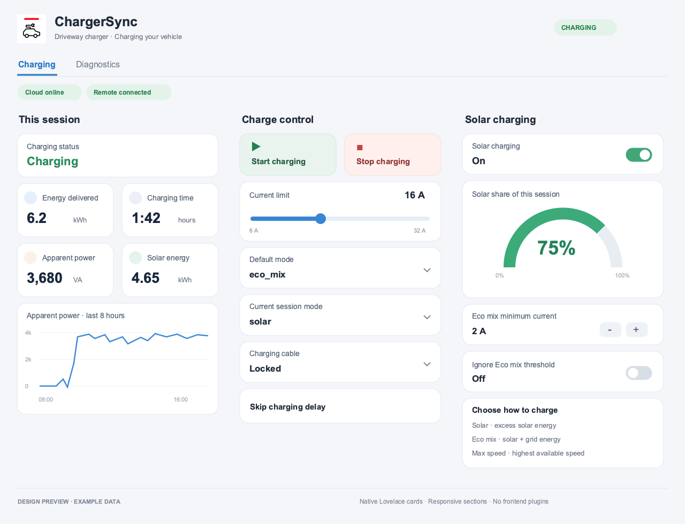

# ABB ChargerSync for Home Assistant

<picture>
  <source media="(prefers-color-scheme: dark)" srcset="custom_components/abb_chargersync/brand/dark_logo@2x.png">
  
</picture>

Custom cloud integration for chargers used with the official ABB ChargerSync app. Based on static analysis of ChargerSync 3.5.0.

**Version 1.0.0.** Automated tests cover Home Assistant and a local server emulator. Live testing has now confirmed REST access, remote login, charging-status reads, and several settings on one charger running firmware 1.8.37. Charging commands, other hardware, and concurrent use with the official app still require validation.

English is the primary language for code and documentation. Integration translations live in `custom_components/abb_chargersync/translations/`, including Dutch in `nl.json`.

## Installation

Requires Home Assistant **2026.10.0 or later**. Tests run on 2026.10.3 / Python 3.14.

1. Copy `custom_components/abb_chargersync` into the `custom_components` directory inside your Home Assistant configuration directory.
2. Restart Home Assistant.
3. Open **Settings → Devices & services → Add integration → ABB ChargerSync**.
4. Sign in with your ChargerSync account email address and password.

Link the charger in the official app first. The integration discovers chargers linked to that account. Accounts without chargers are rejected during configuration. If authentication expires or is revoked, a flow prompts you to sign in again with the same account. The password is not stored; access and refresh tokens are stored in Home Assistant's configuration storage.

Alternatively, add this repository to HACS as a custom repository of type Integration. HACS installation has not been tested; the package structure has been verified for manual installation.

The Git repository is named `ha-abb-cybersync`; the app and integration domain are ChargerSync and `abb_chargersync`, respectively.

## Entities

Available per charger, depending on its responses and supported capabilities:

| Platform | Functions |
|---|---|
| Sensor | Charging status, session energy, duration, L1/L2/L3 current and voltage, solar energy and share, solar current per phase, maximum current, fault code, lifetime energy and lifetime solar energy, installed firmware, available firmware, firmware notice, RFID cards (read-only), grid meter status, and remote logins (diagnostic) |
| Binary sensor | Cloud status, remote connection, charging, and fault |
| Button | Start charging, stop charging, and skip the random charging delay |
| Number | Charging current limit and Eco mix minimum current, in whole amperes; charger sound volume (0–100, experimental) |
| Select | Default and active-session charging modes: `max_speed`, `eco_mix`, `solar` |
| Switch | Free charging without authorization, start/stop charging with session feedback, enable solar charging control, and ignore the Eco mix start/stop threshold |
| Lock | Lock and release the physical charging cable, gated like the app's stuck-cable screen |

The Eco mix minimum current is configurable only when Eco mix is the default mode. Additional thresholds and waiting times are available through actions.

Apparent power is calculated as the sum of U×I and reported in **VA**. It is not measured active power in W. Session readings omitted by the charger outside an active session are not replaced with invented zeros; the corresponding sensors become unavailable. Session sensors are not lifetime energy meters.

**Remote logins** counts cloud WebSocket logins since Home Assistant started. Each login repeats the charger's identity handshake, which can make the charger beep. The integration keeps one connection open per charger, so the count should only rise after Home Assistant restarts, reloads, or a lost connection. Its attributes show whether the connection is open, the last disconnect reason, any reconnect delay, and session takeovers.

The cloud allows one remote session per account. When the official app or another Home Assistant install signs in with the same account, it replaces this integration's session. The integration then waits 10 minutes before reclaiming it, doubling the wait up to 60 minutes if takeovers repeat. Two installs that keep reclaiming the session would otherwise log each other out continuously, and each login can make the charger beep. Use one install per account, or a separate account for testing. Actions you start yourself reconnect immediately.

**Volume** appears when the charger reports a volume in its system information. It uses the SDK's volume command, which the official app does not expose. Whether it affects the login beep, and which other sounds it changes, has not been verified on hardware.

**Lifetime energy** is the charger's own delivered-energy total (SDK command 184, in 0.01 kWh). It survives Home Assistant downtime, so it is the preferred Energy-dashboard meter when the charger reports it. **Lifetime solar energy** comes from command 174, in Wh. A live read confirmed that unit: command 174's total of 4959409 Wh matched command 184's 4959.4 kWh. The official app displays neither value.

**RFID cards** counts the cards the cloud lists for this charger or for the account and shows only their names. Serial numbers authorize charging and are never exposed in entities, diagnostics, or actions. Cards cannot be added or deleted.

**Grid meter status** shows the raw meter and Modbus connection codes from the charger (SDK command 229). The app does not interpret these codes, so the integration shows them unchanged.

**Firmware notice** shows the firmware-upgrade notice that the cloud supplies to the app's charging screen.

The cable lock follows the app's rules: releasing requires a socket outlet and firmware 1.6.8 or later (or an FX device), and locking requires firmware 1.8.2 or later. Chargers with a tethered cable have no lock entity.

The available-firmware sensor shows a version only when the server offers exactly one distinct version. Firmware installation is excluded because the official app requires Bluetooth for it.

## Energy dashboard

The **Charging energy** sensor accumulates observed energy across charging sessions
and restores its counter after a normal Home Assistant restart. Add it under
**Settings → Dashboards → Energy → Individual devices**. A **Solar charging energy**
sensor is also available when the charger supplies solar measurements; it is a subset
of total charging energy. Session display sensors are not Energy-dashboard meters.
See [setup and accounting limitations](docs/energy-dashboard.md).

## EVCC

EVCC can control the charger through its **Home Assistant charger** template.
EVCC connects to Home Assistant's API; this integration communicates with the
charger through the ABB cloud, so internet access is still required.

1. Install or update the integration and restart Home Assistant.
2. In Home Assistant, open the charger's device page and note the entity IDs for
   **EVCC status**, **Charging enabled**, **Charging current limit**, and
   **Charging energy**.
3. Create a long-lived access token from your Home Assistant user profile and
   configure the Home Assistant connection and credentials in EVCC. Use a Home
   Assistant URL that EVCC can reach.
4. Add a **Home Assistant charger** in EVCC and select the entities below, or
   use the YAML example. Replace the URL and example entity IDs with your own.
5. Use **Max speed** charging mode and disable conflicting schedules or solar
   controls in the official app when EVCC should manage charging.

| EVCC parameter | Home Assistant entity | Purpose |
|---|---|---|
| `status` | `sensor.driveway_evcc_status` | A = available, B = connected, C = charging |
| `enabled` | `switch.driveway_charging_enabled` | Charger-derived session feedback |
| `enable` | `switch.driveway_charging_enabled` | Start or stop a charging session |
| `setMaxCurrent` | `number.driveway_charging_current_limit` | Current limit in whole amperes |
| `energy` | `sensor.driveway_charging_energy` | Cumulative observed charging energy in kWh |

Example charger configuration in `evcc.yaml`, after configuring the Home Assistant
credentials in EVCC:

```yaml
chargers:
  - name: driveway
    type: template
    template: homeassistant
    uri: http://homeassistant.local:8123
    status: sensor.driveway_evcc_status
    enabled: switch.driveway_charging_enabled
    enable: switch.driveway_charging_enabled
    setMaxCurrent: number.driveway_charging_current_limit
    energy: sensor.driveway_charging_energy
```

Assign this charger to your EVCC loadpoint. Keep `milliamps` disabled: the current
limit supports whole amperes from 6 A to the charger's maximum. Do not use the
**Apparent power** sensor as EVCC's `power` measurement: it reports VA, not active
power in W. No phase-switching control is exposed.

**Session-control limitations:** the switch reports observed charger state rather
than remembering the last command. Ambiguous states return unknown; offline
entities become unavailable. The protocol does not provide a separate permanent
"charging allowed" flag, so starting while unplugged does not guarantee that a
future connection is authorized. Polling defaults to 30 seconds. Verify start,
stop, vehicle sleep/wake and reconnect with your charger before unattended use.

See [EVCC setup and feedback details](docs/evcc.md),
[energy accounting limitations](docs/energy-dashboard.md), and the
[EVCC Home Assistant charger documentation](https://docs.evcc.io/en/chargers/home-assistant-charger/).

## Lovelace dashboard

A ready-to-customize dashboard is included in `dashboards/chargersync.yaml`. It provides **Charging**, **Diagnostics**, and **Management** views, with native cards for measurements and controls and a bundled management card for schedules, history, tariffs, reports, and logs. The integration automatically loads the card module; no separate frontend installation is required.



This is an illustrative layout preview, not a live screenshot. Match the entity IDs to your charger before importing. See the [dashboard setup guide](docs/dashboard.md), including an entity-ID generator and optional logo setup.

## Cloud actions

All actions use the `abb_chargersync` domain and take a `device_id`: the charger's Home Assistant device ID. The action editor provides a device picker.

| Action | Purpose |
|---|---|
| `get_data` | Return sessions, trends, schedules, tariffs, automatic reports, firmware packages, currencies, timed current limits, solar thresholds, log metadata, or logs |
| `create_schedule` | Create a charging schedule |
| `update_schedule` | Update an existing charging schedule |
| `delete_schedule` | Delete a charging schedule |
| `set_price` | Update tariff settings while preserving other fields |
| `set_auto_export` | Configure automatic reports |
| `export_sessions` | Ask ChargerSync to email a report |
| `set_company_session` | Mark a session as company or private use |
| `replace_load_limits` | Replace the complete list of timed current limits |
| `set_solar_offsets` | Update selected solar thresholds and waiting times |
| `update_charger` | Change the charger name in the cloud |
| `refresh` | Immediately refresh inventory, settings, and charging status |

See [action examples and parameters](docs/actions.md). Actions return data through responses rather than large entity attributes. The official cloud performs exports; the integration does not send email itself.

## Free charging

The device's **Free charging** configuration switch enables charging without RFID
or other authorization, matching the official app's free-vending setting. It does
not mean electricity is free and is separate from the **Charging enabled** session
start/stop switch. The integration reads the current device configuration before
changing this bit and preserves the other configuration bits. The switch appears
when the charger successfully reports the setting; a failed read makes it
unavailable rather than assuming a value.

See the [app feature gap analysis](docs/research/app-feature-gaps.md) for remaining differences.

## Exclusions

- Authorization management: RFID cards, permissions, account registration/deletion, password management, charger binding/unbinding, and PIN resets. Use the official app.
- Bluetooth transport and device-specific Bluetooth cipher management.
- Network configuration and firmware installation: the official app requires Bluetooth for these screens.
- Installer functions found only as generic SDK capabilities, such as OCPP server changes, Modbus/meter configuration, electrical protection, VIN whitelists, I/O, and resets. Cloud support has not been established, and there is no generic raw-command action exposing them.
- Mobile-app features such as push-token registration, app ratings, and phone-local settings.

## Updates and error handling

Remote data is polled every 30 seconds by default, configurable from 15 to 300 seconds. Cloud inventory, tariffs, schedules, report settings, and firmware packages refresh every five minutes. An explicit refresh also retrieves these resources again.

Commands are serialized per charger. Broken or ambiguous connections are closed. A write is not automatically repeated after a timeout because its outcome may be unknown. Unsupported optional functions are remembered for the current integration run; reloading tries them again. Firmware changes may therefore require a reload.

Offline devices do not prevent integration setup. Entities become available when the charger responds again, and newly discovered capabilities or newly linked chargers appear automatically. Unlinked devices are no longer controlled; their existing entities become unavailable and can be removed through Home Assistant.

Diagnostics include only model/firmware information, field names, and capability status, excluding tokens, email addresses, device numbers, PINs, and session history. History/export action responses may contain personal data; avoid sharing them unintentionally.

## Local testing with Docker Compose

Start a separate Home Assistant instance with the integration mounted directly from this repository:

```sh
docker compose up -d
```

Open [http://localhost:8123](http://localhost:8123), complete onboarding, and add ABB ChargerSync through the integration flow. Configuration data and tokens stay under the Git-ignored `.local/homeassistant/` directory. Code changes require `docker compose restart homeassistant`; no image rebuild is needed.

See the [local testing guide](docs/local-testing.md) for environment overrides, logs, configuration checks, and Lovelace setup. Adding the integration connects to the real vendor cloud; this is not a mock charger.

## Development

```sh
python3.14 -m venv .venv
.venv/bin/pip install -r requirements-dev.txt
.venv/bin/ruff check custom_components tests scripts
.venv/bin/ruff format --check custom_components tests scripts
.venv/bin/pytest -q
```

Tests use synthetic data and a local cloud emulator, without real account credentials. `scripts/generate_service_descriptions.py` generates action editor descriptions from the action schemas. Run it from the repository root with `PYTHONPATH=.`.

[Architecture and protocol limitations](docs/implementation.md) · [APK research](docs/research/apk-research.md) · [Technical appendix](docs/research/technical-appendix.md)

## Branding

The original ChargerSync logo and app icon are extracted from the supplied Android package and bundled with the integration. Light and dark logo variants are included. See [asset provenance](docs/branding.md).

## Changes in 1.0.0

- Kept the charger's cloud connection open instead of logging in again. Each login can make the charger beep.
  - A rotated OAuth access token no longer forces a new WebSocket login. The WebSocket uses the profile session, not the OAuth token.
  - A command the charger or cloud rejects with a complete reply no longer closes the connection. Only timeouts, transport errors, and corrupt streams do.
  - A background reader processes cloud messages between polls, as the official app does. Lost connections and device-disconnect notices are detected immediately, and WebSocket pings are answered promptly.
  - A stale REST offline flag no longer closes a live connection.
- Added a longer backoff when another client takes over the account's cloud session. The previous behaviour of reclaiming the session at once made two clients log each other out.
- Added reconnect backoff. After one immediate retry, reconnects wait 30 seconds, doubling up to 10 minutes. A connection that lasted 5 minutes resets the backoff. Actions you start yourself always reconnect immediately.
- Added the **Remote logins** diagnostic sensor and connection details in diagnostics.
- Added an experimental **Volume** number entity, using the SDK's system-information read (command 177) and volume command (178).
- Added **Lifetime energy**, **Lifetime solar energy**, **Grid meter status**, read-only **RFID cards**, and **Firmware notice** sensors.
- Added `rfid_cards` and `firmware_notice` resources to the `get_data` action.
- Applied the app's cable capability rules to the lock entity.

## Changes in 0.2.2

- Load the card exclusively as a Lovelace resource. Loading it as an extra frontend
  module could register it before HA replaces the native custom-element registry,
  causing the card picker to report that the custom element was not found.
- Refresh the browser after upgrading to discard the old registry and module cache.

## Changes in 0.2.1

Version 0.2.2 also fixes custom-card startup: assets are published before cloud
discovery, and the card is registered as a versioned Lovelace module in resource
storage mode. Refresh the browser after upgrading.

## Changes in 0.1.1

- Fixed WebSocket authentication to use the user profile's `authen` and `sessionId`, rather than the REST OAuth access token.
- Accepted variable-width current-limit replies and trailing status extensions, matching the Android SDK parser.
- Kept successful settings when another setting fails, so one unavailable capability no longer hides the remaining controls.
- Treated temporary configuration rejections as retryable rather than permanently unsupported.
- Added credential-free connection stages and per-setting failures to logs and diagnostics.

Upgrade the integration files and restart Home Assistant to apply these fixes. The development Compose instance loads them from the repository bind mount after a restart.
