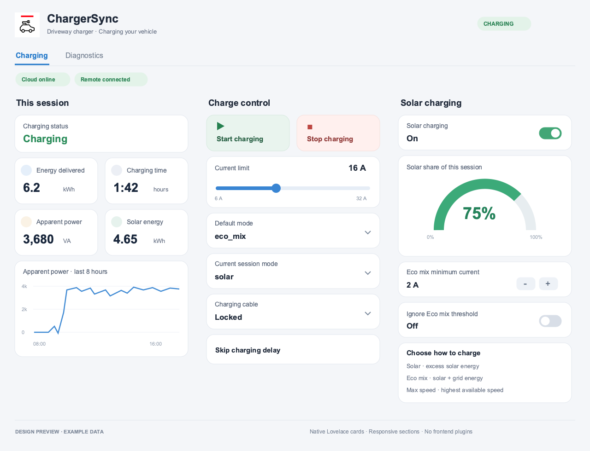

# ChargerSync Lovelace dashboard

A native Home Assistant dashboard with two views: **Charging** and **Diagnostics**. It uses built-in Sections, Tile, Gauge, Markdown, Heading, and History graph cards. No custom cards, HACS frontend resources, themes, or helper entities are required.



The preview is a design illustration with synthetic example readings, not a screenshot from a live Home Assistant instance. Exact spacing and colors follow your Home Assistant theme.

## Layout

The Charging view uses up to three columns on a desktop and stacks sections on smaller screens:

1. **This session:** charging status, energy delivered, duration, apparent power, solar energy, and an eight-hour apparent-power graph.
2. **Charge control:** start/stop, a device-bounded current slider, default and current-session modes, cable controls, and skip-delay action.
3. **Solar charging:** solar enable/disable, solar-share gauge, Eco mix minimum current, threshold setting, and a short explanation of charging modes.

The header uses the original app icon, a charger name, live status text, and connection badges. Offline and fault notices appear when the corresponding state is reported. Charging controls are hidden while the remote connection is offline. Opening the cable tile shows Home Assistant's lock controls; the integration rejects cable operations during charging.

The Diagnostics view contains per-phase voltage/current/solar-current readings, current graphs, connection history, fault information, hardware current limit, and installed firmware.

Optional measurement cards are hidden when readings are missing, unknown, or unavailable. Phase L2/L3 cards therefore do not require a three-phase charger. The Eco mix minimum-current control appears only when Eco mix is selected and its value is available. Firmware availability remains on the integration's device page because an offered version is not guaranteed to exist on every device.

Charts use Home Assistant Recorder history, not the cloud's charging-session history API. They need recorded entities and do not reconstruct readings from before the integration was installed. Session measurements and their charts may disappear outside an active session; cloud session history remains available through integration actions. No lifetime energy, vehicle SOC, billing estimate, or active-power measurement is invented.

## 1. Match your entity IDs

The template at `dashboards/chargersync.yaml` uses entity IDs such as `sensor.charger_charging_status`. Home Assistant creates IDs from your device name; renamed entities or naming collisions can produce different IDs.

Find the charging-status sensor under **Settings → Devices & services → ABB ChargerSync → your charger**, or in **Developer tools → States**.

For `sensor.driveway_charging_status`, generate a personalized dashboard using `driveway` as the prefix:

```sh
.venv/bin/python scripts/generate_dashboard.py \
  --entity-prefix driveway \
  --name "Driveway charger" \
  --output work/chargersync-driveway.yaml
```

The generator updates cards, visibility conditions, button targets, and entity references inside the Markdown header. It does not connect to Home Assistant or modify the integration.

If you prefer manual editing, replace every `.charger_` prefix in the template with your actual prefix and replace `CHARGER_DISPLAY_NAME` with your desired heading. Do not change the `abb_chargersync` integration domain.

For individually renamed entities, provide a JSON mapping from the original template ID to the actual ID:

```json
{
  "sensor.charger_session_energy": "sensor.ev_session_energy",
  "number.charger_charging_current_limit": "number.ev_charge_limit"
}
```

```sh
.venv/bin/python scripts/generate_dashboard.py \
  --entity-prefix driveway \
  --name "Driveway charger" \
  --entity-map work/entity-map.json \
  --output work/chargersync-driveway.yaml
```

Check entity IDs before importing. The generator cannot inspect your Home Assistant instance and does not guarantee matches for customized names.

## 2. Install the header icon

Copy `custom_components/abb_chargersync/brand/icon.png` to `www/abb_chargersync/icon.png` inside your Home Assistant configuration directory. Create those directories if needed. This makes the image available at `/local/abb_chargersync/icon.png`, which the dashboard header uses. If you created `www` for the first time, restart Home Assistant.

The local app icon has a white background and remains legible in both light and dark themes. If you do not want the image, remove the `` line from the header Markdown; the rest of the dashboard works without it.

## 3. Add the dashboard

1. Open **Settings → Dashboards** and create a new dashboard from scratch.
2. Open the new dashboard and enter edit mode. Take control if prompted.
3. Open the **Raw configuration editor** from the dashboard's three-dot menu.
4. Paste the complete generated YAML, including `title` and `views`, then save.
5. Exit edit mode to check conditional visibility. Home Assistant can show conditional cards while editing even when their runtime conditions are false.

Use a new dashboard: pasting the complete configuration replaces the contents of the dashboard you are editing. To add the design to an existing dashboard, append the two entries under `views` rather than replacing its complete configuration.

For YAML-mode dashboards, put the generated file at `dashboards/chargersync.yaml` under your Home Assistant configuration directory and add:

```yaml
lovelace:
  dashboards:
    chargersync-dashboard:
      mode: yaml
      title: ChargerSync
      icon: mdi:ev-station
      show_in_sidebar: true
      filename: dashboards/chargersync.yaml
```

Merge this into any existing `lovelace` configuration instead of adding a duplicate key. The dashboard key includes a hyphen as required by Home Assistant.

## Multiple chargers and advanced actions

Generate a separate dashboard for each charger or merge the generated views into one dashboard, giving each view a unique `path` and title. The integration does not automatically install or register Lovelace dashboards.

Schedules, tariff editing, exports, and reports are available through the documented [integration actions](actions.md). They are not represented as pretend live entities or UI forms that lack the underlying helper/response handling. Authorization management and Bluetooth features remain outside scope.

## References

- [Sections view](https://www.home-assistant.io/dashboards/sections/)
- [Tile controls and card features](https://www.home-assistant.io/dashboards/features/)
- [Conditional cards](https://www.home-assistant.io/dashboards/conditional/)
- [Dashboard actions](https://www.home-assistant.io/dashboards/actions/)
